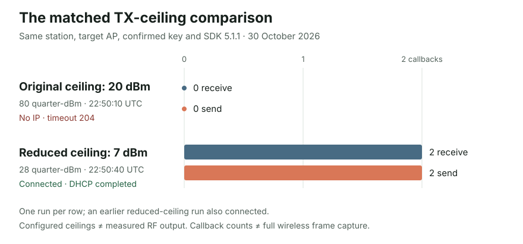

# The SenseCAP that could see Wi-Fi but could not join it

The second SenseCAP Indicator D1 was supposed to show a German word clock and Claude usage on its 480 × 480 screen. It could start its own setup hotspot, show QR codes, and serve the phone setup page. The phone could choose the home network and submit its credentials. Then the device waited and reported that the connection had failed. Moving the box close to the router did not help.

The final fix was unexpectedly specific: when certain connection timeouts occur at a strong received signal, the firmware restarts Wi-Fi and retries once with a lower *configured maximum transmit-power setting*. With that change, this ESP32-S3 connected to the tested FRITZ!Box, obtained an IP address, and did so again after a reboot. We have a working device-side fix for this pairing. We still do not know which electrical or driver-level effect makes the lower setting matter.

Getting there required more than reading a disconnect code. We had to establish which network and key we were actually testing, separate the setup application from the radio, compare another access point, and finally reverse one setting while holding the rest of the station test constant.

## Understanding the handshake timeout

Our first useful measurement was the Wi-Fi disconnect reason. The device was often reporting **204**, which ESP-IDF names a handshake timeout. A WPA2 connection includes a security exchange after the station finds and associates with an access point; reaching neither an IP address nor an application server tells us very little about which earlier step failed. Reason 204 narrows the search, but [Espressif lists it under both password-related and low-signal problems](https://docs.espressif.com/projects/esp-idf/en/v5.1.1/esp32s3/api-guides/wifi.html#wi-fi-reason-code-related-to-wrong-password). We could not honestly translate it into “wrong password.”

There was reason to question the input at first. The selected network name and credentials in the early setup attempts did not consistently refer to the same network. We corrected that before treating any connection trial as evidence. The decisive tests used the intended network and a current key confirmed from the router configuration. Tests performed with an earlier, different value do not support the eventual conclusion. No key, derived secret, or protected setup URL is part of this post.

We also made the phone wizard tell the truth about its progress. A test now has an attempt identity and a deadline; its result depends on an actual station connection, an IP address, and a successful credential save. Disconnect diagnostics carry a numeric reason and valid received signal strength into the worker without logging the network name or password. Separately, we fixed a retry race: an old disconnect could arrive after the next attempt had started and make that attempt look like a failure. The firmware began waiting for fresh Wi-Fi stop and start events before treating the radio as ready again.

That application correction made the setup flow more reliable, but it did not make the minimal Wi-Fi test connect. This distinction mattered. We had improved how the app handled failure; we had not yet removed the failure itself.

## Strip the experiment down to one station

We temporarily ran diagnostic firmware that skipped the UI, OAuth, QR handling, and phone form. It supplied the confirmed credentials to the ESP32-S3 station from RAM and waited for Wi-Fi events. We checked that the driver received the intended configuration, and compared password-derived values without recording the values themselves. The station still failed against the home router.

We then changed plausible factors one at a time. Using a pre-derived PSK instead of the passphrase did not help. Neither did turning power saving off, restricting protocols to 802.11b/g, changing Wi-Fi NVS initialization, omitting the preliminary scan, or testing a different locally administered station address. We exercised the actual PMF-disable API; the connection still failed. Isolated builds with ESP-IDF 5.1.6 and 5.1.7 also failed. A 5.5.6 diagnostic was prepared but never flashed, so it provides no connection result. The [sanitized experiment ledger](wifi-connection-evidence.json) records the individual outcomes without credentials or local network identifiers.

Those trials were useful mainly because they prevented a convenient story from hardening into an untested assumption. The target router advertised WPA2-PSK with CCMP and did not require protected management frames in the observed beacon. A suspected WPA3 setting was a poor fit for this case; turning PMF off did not change the result. An SDK upgrade was similarly unpersuasive after the tested patch versions still failed. None of this says those settings are irrelevant to every Wi-Fi problem. It says they did not resolve this one in the controlled trials we ran.

Searching other projects gave us context, not an answer. A [Tasmota discussion](https://github.com/arendst/Tasmota/discussions/14986) described other ESP32 devices that could join a hotspot but struggled with a FRITZ!Box. That involved different hardware and software, yet suggested a discriminating experiment: could this board join a different access point at all? Tasmota also has a [FRITZ!Box-related wait option](https://tasmota.github.io/docs/Commands/#setoption142). We checked its [source](https://github.com/arendst/Tasmota/blob/development/tasmota/tasmota_support/support_wifi.ino): the one-second wait happens after starting connection. Our direct trial already allowed much longer. Copying that option would have been a guess.

## A second access point changed the question

There was no spare router, so we used the Mac's Ethernet connection to create a temporary 2.4 GHz Wi-Fi access point. [Apple documents Ethernet-to-Wi-Fi Internet Sharing](https://support.apple.com/en-sg/guide/mac-help/mchlp1540/27/mac/27); we used it only as a control and switched it off afterward.

The same minimal station program on ESP-IDF 5.1.1 connected to that access point and received an IP address. We kept the board's factory station address. At an observed signal around **−27 dBm**, our software hooks saw two calls at the WPA receive boundary and two at the send boundary. Against the home router, previous failed trials had shown no calls at those same hooks.

This was a real distinction. The board could complete a Wi-Fi connection elsewhere, so a blanket claim that its station mode was broken no longer fit. But the Mac and router were different access points on different channels, so we could not call it a clean experiment on router vendor alone. Nor did successful reception at a strong RSSI prove the station's outgoing signal was healthy. RSSI in these logs describes signal received by the SenseCAP; it does not measure what the router receives from it.

The next test had to stay on the failing router and change less.

## The result that held up when we reversed it

ESP-IDF exposes a maximum Wi-Fi transmit-power setting after the radio starts. The API uses **quarter-dBm units**. The driver reported **80** for the original ceiling, corresponding to **20 dBm**. We set **28**, corresponding to **7 dBm**, and read the value back. These are configured and reported maximums, **not measured radiated output**; the exact API mapping is in [Espressif's version-pinned public header](https://github.com/espressif/esp-idf/blob/v5.1.1/components/esp_wifi/include/esp_wifi.h).

With the reduced ceiling, the direct station test connected to the home router and completed DHCP. We did not stop at that one success. We rebuilt the same station test with the ceiling left at 80: it failed with reason 204 and obtained no IP address. We put the ceiling back to 28: it connected and obtained an IP address again. The confirmed key, factory station address, SDK version, target router, and other test settings were held constant in that matched pair. The observed received signal was about **−20 dBm** in both runs.

At the instrumented WPA boundaries, the original-ceiling run recorded **zero receive and zero send callbacks**; the reduced-ceiling run recorded **two and two**. Those are software callback counts from individual runs, not a full over-the-air capture or a success-rate estimate. An earlier reduced-ceiling run had also connected. Together, the reversal and repeat made the transmit-power ceiling a practical way to get this device onto this access point. The [technical record](wifi-connection-investigation.md) includes exact times, unsuccessful controls, and the sanitized evidence behind the figure.

There is an important boundary to that conclusion. A lower configured ceiling can alter radio behavior, but we did not measure supply current, actual RF power, waveform quality, or what the FRITZ!Box heard. We cannot identify a failing component, assert that the board was transmitting too loudly, or say which internal driver state changed. The experiment demonstrates that the connection outcome depended reproducibly on this setting in the tested setup. It does not tell us why.

## Making the workaround safe enough for normal firmware

A diagnostic that always uses 7 dBm is easy to write. A product that opens a temporary hotspot, tests credentials from a phone, reconnects after reboot, and reports errors honestly needs a narrower rule. Reducing the ceiling globally might needlessly hurt range on other networks. We kept the original setting as the default and added a bounded fallback in the [Wi-Fi manager](../main/wifi_manager.c).

On startup, the manager reads the driver's actual ceiling rather than assuming it will be 80. It attempts to connect at that original value. If a connection attempt has **not** obtained an IP address, it may qualify for one reduced-power retry. The [policy](../main/wifi_tx_policy.c) requires a known original ceiling above 28, valid RSSI from **−40 to −1 dBm**, and a disconnect reason of **2, 15, 39, or 204**. Each logical attempt can take that fallback once. Other failures, missing signal measurements, and weak reception continue through the usual failure or retry path. Those thresholds are a conservative rule for this observed case, not a new definition of what the Wi-Fi reason codes mean.

The first integrated attempt exposed another trap. We lowered the setting and retried quickly, but that retry produced a generic connection failure without valid RSSI. Rather than infer a hidden driver blacklist, we used the public Wi-Fi lifecycle: stop the radio, wait for a *new* station-stop event, start it, wait for a *new* station-start event, then apply the reduced ceiling, verify its readback, and retry after a short delay. [Espressif documents that stop and start free and recreate the station control block](https://docs.espressif.com/projects/esp-idf/en/v5.1.1/esp32s3/api-reference/network/esp_wifi.html). Event counters and watchdogs keep a late event from the previous connection from satisfying this barrier.

We also had to broaden the eligibility rule to cover the timeout family the normal firmware actually reported. The successful normal boots first reported reason **39**, despite the direct baseline trial having reported **204**. A fix that reacted to only one diagnostic run's code would not have activated on the shipped application.

The ordinary setup attempt has a **25-second first phase**, long enough for the observed failure around 20 seconds to arrive, and a **20-second reduced-power phase** starting at the actual retry call. A successful low-power session keeps that ceiling while connected. A later link loss, new credentials, Forget Wi-Fi, or terminal failure restores the original ceiling at a safe point. Each new normal-power reconnect cycle can earn one fallback; the low-power retry cannot start another low-power retry. Nothing about this power choice is stored as a permanent hint, so a reboot begins with the driver's normal setting again.

We treat failed power restoration as a real error. If the driver will not return to the measured original ceiling, the manager records a fault and refuses new phone connection tests with HTTP 503 rather than silently starting another test in an unknown radio state. The phone's setup attempt and protected page survive the fallback, although the brief radio restart can disconnect the phone from the temporary hotspot. In that case it may need to rejoin the same setup network.

The [host tests](../tests/test_wifi_setup_flow.py) exercise the production worker logic with stubbed ESP-IDF calls under sanitizers, including stale events, failures to set or restore power, fallback limits, and saved-credential reconnects. [Policy tests](../tests/test_wifi_tx_policy.py) cover which reasons and signal values qualify. Independent review caught two edge cases before release: a saved-credential retry needed a fresh fallback budget for each new normal-power cycle, and a failed restoration had to block the phone test *before* reserving an attempt. We fixed both.

## The full firmware connects again after a reboot

We built the normal **`0.14.7-wifi-tx-retry`** application with the project's pinned **ESP-IDF 5.1.1** and flashed it to the existing application partition. The verified Wi-Fi credentials were saved through the production storage path after the diagnostic had obtained an IP address. The normal firmware contained neither the temporary USB diagnostic helper nor a literal test key.

On the first normal boot, the device started at the original ceiling, saw a qualifying timeout, restarted Wi-Fi, set and verified the reduced ceiling, and got an IP address. It synchronized its clock and made the Claude account setup page available. We rebooted it: the saved credentials took the same recovery path and connected again. Each boot had a **20-second observed period after IP acquisition with no further disconnect**. Ping, local name resolution, and reachability of the protected setup HTTP server worked from the Mac. The full Python unit and host suite passed **68 tests**, including **three targeted sanitizer-backed suites**, and the normal firmware build passed.

That is a meaningful end-to-end result for Wi-Fi and startup, with a deliberately short observation window. We have not completed Claude sign-in or verified authenticated usage on this second box, and two 20-second windows do not establish long-term reliability. There was no need to change the router's security or radio settings for the working fix; an earlier, authorized Wi-Fi event logging change had been restored before the final comparison. Temporary credentials and credential-bearing diagnostic builds were removed.

The next useful tests are a longer connected run, several cold starts, a complete phone provisioning attempt through the fallback, and the Claude sign-in and usage flow. If the workaround is to be used on other hardware, range and performance need testing too. For now, the useful finding is precise: the same confirmed key failed at the original ceiling, succeeded twice at the reduced ceiling in the direct test, and the bounded retry brought the normal firmware online across two boots. The radio's physical reason for that dependence remains open.

Further detail is in the [full investigation and source index](wifi-connection-investigation.md), with [sanitized observations](wifi-connection-evidence.json). The external sources most useful to the investigation were the [ESP-IDF 5.1.1 Wi-Fi driver guide](https://docs.espressif.com/projects/esp-idf/en/v5.1.1/esp32s3/api-guides/wifi.html), the [version-pinned transmit-power API](https://github.com/espressif/esp-idf/blob/v5.1.1/components/esp_wifi/include/esp_wifi.h), and the [Tasmota FRITZ!Box discussion](https://github.com/arendst/Tasmota/discussions/14986), which prompted a control experiment rather than supplying the fix.
