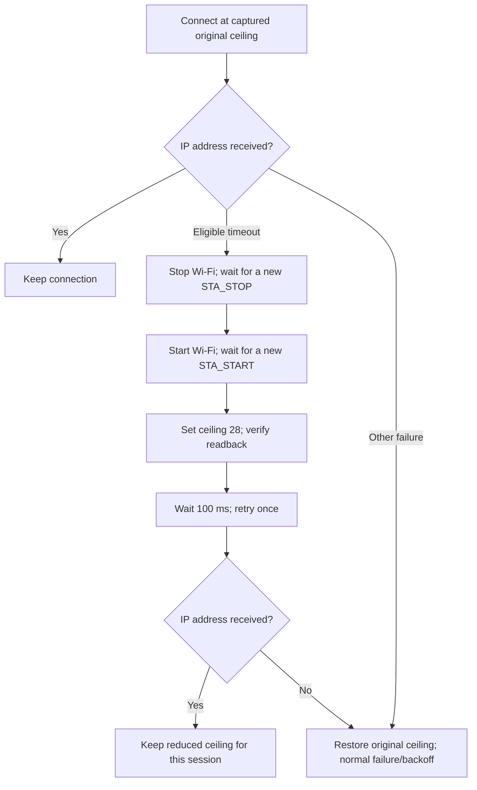

# SenseCAP Wi-Fi handshake failures: investigation and adaptive TX fix

**Incident:** second SenseCAP Indicator D1, ESP32-S3, October 2026.

**Working release:** `0.14.7-wifi-tx-retry`, validated overnight on 30–31 October 2026.

**Scope:** connecting to a FRITZ!Box 6660 Cable running FRITZ!OS 8.25, using 2.4 GHz WPA2-Personal.

The device repeatedly failed to join the router, even with a router-confirmed password and strong received signal. A controlled station-only test isolated a working change: lowering the driver's maximum transmit-power setting from **80 to 28 quarter-dBm**, equivalent to configured ceilings of **20 to 7 dBm**. The same confirmed credentials then completed connection and DHCP. Repeating the original ceiling reproduced the failure; repeating the reduced ceiling reproduced success.

The production fix preserves normal power initially. For selected connection timeouts with strong signal, it performs a confirmed Wi-Fi stop/start, applies and verifies the reduced ceiling, and makes one bounded retry. The complete application connected after flashing and again after a subsequent reboot.

This establishes an effective device-side fix for the tested device/router combination. It **does not establish the electrical cause** of the power-dependent behavior or prove that every ESP32-S3 needs reduced transmit power. The settings above are driver-reported ceilings, not measurements of radiated RF power. The units and quantization come from the [version-pinned Espressif API header][tx-api].

## What the user saw

The temporary setup hotspot and local phone page worked. The phone could select a network and submit “Connect and test,” but the device reported failure after roughly 20 seconds. Moving it near the router did not resolve the problem. The Mac could connect to the router, so a general router outage was unlikely; that alone did not prove the SenseCAP had completed its own security exchange.

Initially, the selected network name and supplied credential values were inconsistent across inputs. We corrected the intended network and obtained the current key directly from the authorized router configuration. **Earlier tests using a different key were excluded from the decisive comparisons.** No passwords, derived keys, device addresses, or protected setup links are reproduced here.

## How we narrowed it down

### 1. Separate application failures from radio failures

We first made the setup flow observable: a connection attempt had an identity, a bounded deadline, reason-specific errors, and numeric diagnostics. A disconnect event copied its reason and valid RSSI into the worker queue. The worker logged attempt state and elapsed time without dumping credential structures.

The important code was **204**, the SDK's handshake-timeout result. Espressif documents it in both password-related and low-signal troubleshooting; it is not a password verdict. Other experiments also produced **2** and **39**, which are timeout-related results, and an initial retry implementation encountered **205**, a general connection failure. See the [ESP-IDF 5.1.1 reason-code guide][wifi-guide].

We also found an independent application bug: a delayed disconnect from an old attempt could interfere with a newer one. Release `0.14.6-wifi-recovery` added a stop/start event barrier to separate attempts. That improved retry correctness, but the minimal station test still failed. Fixing the wizard was therefore necessary but insufficient.

### 2. Bypass the phone page and the full application

Private diagnostic firmware connected directly as a station using the confirmed credentials in RAM. This removed the browser form, QR flow, LVGL, OAuth, and most application scheduling from the experiment.

Configuration readback and an independent password-to-key calculation agreed with the intended inputs, recorded as match booleans rather than secret values. The direct connection still failed. That made a form-encoding or truncation bug an inadequate explanation for the remaining failure.

Temporary wrappers counted calls at `wpa_sm_rx_eapol` and `wpa_ether_send` while preserving their arguments and return values. They recorded counts only: no EAPOL bodies, nonces, passwords, or keys. Zero callbacks in a failed run describes these observation points; it is not proof that no wireless frame was transmitted anywhere in the stack.

### 3. Test plausible software and security explanations

The following were diagnostic experiments, not changes all shipped together. The unsuccessful controls below used the corrected network and confirmed key.

| Record | Experiment | Observed result | What it told us |
| --- | --- | --- | --- |
| C1 | Minimal station, ESP-IDF 5.1.1, confirmed passphrase | No IP; handshake timeout | Failure survived removal of the setup page and main UI. |
| C2 | Pre-derived 64-character PSK instead of passphrase | No IP | Changing passphrase derivation did not resolve it. |
| C3 | Modem power saving disabled | No IP | That power-save change was insufficient. |
| C4 | Restrict PHY protocols to 802.11b/g | No IP | Removing 802.11n was insufficient. |
| C5 vs C1 | SDK Wi-Fi NVS initialization enabled versus disabled | No IP | This initialization difference did not resolve it. |
| C6 | Isolated ESP-IDF 5.1.6 build | No IP; reason 204 | A patch-level SDK change alone was insufficient. |
| C7 | Alternate locally administered station MAC | No IP | Changing station identity alone was insufficient; factory MAC was restored. |
| C8 | Explicit PMF disable API | No IP; reason 204 | Disabling PMF did not resolve the tested case. |
| C9 | Omit the explicit preliminary scan | No IP; reason 39 | That scan was not required to reproduce failure. |
| C10 | Isolated ESP-IDF 5.1.7 build | No IP; reason 2 | Another SDK patch release alone was insufficient. |
| No radio trial | ESP-IDF 5.5.6 preparation | Built; **not flashed** | No connection result can be claimed for this version. |

Records **C1–C10** in the [sanitized evidence summary](wifi-connection-evidence.json) identify each private source record by basename, timestamp, and scalar outcome. The original records remain private; this appendix is a curated extract, not a replacement for the full operator logs.

The router configuration and observed beacon security fields showed WPA2-PSK/CCMP without PMF support/requirement in the observed advertisement. WPA3-SAE configuration was therefore not an established explanation. For the PMF experiment, we used the actual disable API rather than assuming a deprecated configuration flag disabled it; see [Espressif's security guide][wifi-security].

These tests did not require erasing account or identity storage. They should not be described as entirely NVS-write-free: normal PHY initialization can use calibration storage. The isolated SDK tests also did not migrate the production firmware away from 5.1.1.

### 4. Use a second access point as a control

With no second router available, we temporarily shared the Mac's Ethernet connection over a 2.4 GHz Wi-Fi hotspot. The same minimal station implementation, ESP-IDF 5.1.1, and factory MAC connected and obtained an IP address, with observed RSSI around **−27 dBm**. The WPA callback counts were **2 receive / 2 send**. The temporary hotspot was subsequently disabled. Apple's supported setup is documented in [Internet Sharing][apple-sharing].

This demonstrated that the board could complete a station connection to another access point. It did not establish that every part of its RF path was fault-free. The Mac used channel 6 and the target router channel 11, so this was not a single-variable comparison of router vendors.

### 5. Change only the transmit-power ceiling

The decisive paired tests returned to ESP-IDF 5.1.1 and the target router. The station source, confirmed key, factory MAC, security, and other test settings were held constant between the matched builds. The driver ceiling was explicitly logged before and after configuration.

| Run, UTC on 30 October 2026 | Configured/read-back ceiling | Observed RSSI | WPA receive/send callback counts | Result |
| --- | --- | --- | --- | --- |
| First reduced-power run, 22:46:58 | 80 → **28** | −20 dBm | 2 / 2 | Connected; DHCP completed |
| Matched original-power control, 22:50:10 | 80 → **80** | −20 dBm | 0 / 0 | No IP; reason 204 |
| Matched reduced-power confirmation, 22:50:40 | 80 → **28** | −20 dBm | 2 / 2 | Connected; DHCP completed |


The chart shows two individual matched runs, not a success-rate estimate or RF measurement. The earlier reduced-power success provides a separate repeat. The attached [sanitized evidence summary](wifi-connection-evidence.json) preserves observation times and outcomes without local network identifiers.

The successful reduced-power runs used the same confirmed key that failed at the original ceiling. This is the strongest evidence that the remaining failure was not explained by an incorrect key in those runs. Strong received RSSI measures reception from the AP; it does not establish the quality of the station's outbound transmission or the electrical conditions during it.

## What prior research contributed

Other projects had reported ESP32 devices connecting to phone hotspots while struggling with FRITZ!Box routers. [Tasmota discussion #14986][tasmota-discussion] was a useful precedent for testing another AP, but involved different hardware/software and did not establish our cause.

Tasmota also documents [SetOption142][tasmota-option] for some FRITZ!Box connection issues. We checked the [implementation][tasmota-source]: it calls `waitForConnectResult(1000)` after beginning the connection. It is not evidence for a universal “sleep before connecting” fix. Our direct diagnostic already allowed substantially longer for connection, so we did not adopt that option as the solution.

The [5.1.7 release][idf-517] and [5.5.6 release][idf-556] informed isolated SDK comparisons. Their existence was not evidence that an upgrade would fix this device. The working production solution remained on the project's pinned ESP-IDF 5.1.1.

## Turning the working experiment into a production fix

Setting low power once in a diagnostic was not enough. The application needed bounded recovery, correct event ordering, honest phone status, and safe restoration of the previous setting.

### Eligibility and bounds

The pure policy in [wifi_tx_policy.c](../main/wifi_tx_policy.c) permits fallback only when all of these hold:

- The reason is **2, 15, 39, or 204**.
- RSSI is valid and lies between **−40 and −1 dBm**, inclusive.
- The original ceiling is known and above 28 quarter-dBm.
- This connection cycle has not already used its reduced-power retry.

The [manager](../main/wifi_manager.c) additionally requires an active connection attempt without an IP address. Ordinary authentication failures, missing APs, weak/unknown signal, and unrelated errors keep their existing handling. These thresholds are a conservative application policy based on the observed case, not a new interpretation of the Wi-Fi standard.

The first setup phase allows **25 seconds**, giving the observed SDK failure near 20 seconds time to arrive. The reduced-power phase allows **20 seconds from its actual connect call**. Lifecycle recovery has separate watchdogs, so these phase durations are not a promise that every attempt finishes in exactly 45 seconds.

### Confirm the lifecycle before retrying

The implementation performs this sequence:



An early integrated candidate merely lowered the ceiling and retried after a delay. It encountered reason 205 without valid RSSI. The successful version first established the stop/start barrier. Espressif documents that stop/start tears down and recreates the station control block; we do **not** claim to have proven an internal driver blacklist or a particular hidden driver defect. See the [Wi-Fi lifecycle API][wifi-api].

New lifecycle events are checked against counters captured before the operation, so old queued events cannot satisfy the barrier. Late disconnect/IP events during recovery do not complete or fail a newer phase. The first barrier candidate also needed its eligibility expanded from handshake codes alone to the observed timeout-family codes 2 and 39.

### Preserve application state and restore power deliberately

The original ceiling is read from the running driver rather than assumed to be 80. Applying the reduced ceiling requires a successful setter and exact getter readback. A successful connection retains the reduced ceiling for that session. Later link loss, a new credential attempt, Forget Wi-Fi, or terminal retry failure restores the captured original ceiling at the appropriate running-radio point.

Each new normal-power saved-credential cycle may earn one fallback; the queued low-power retry cannot recursively earn another. No persistent power hint is stored: a reboot starts normally and adapts again if necessary.

If restoration fails, a fault flag blocks new phone connection tests with HTTP **503** before reserving an attempt. The application does not silently continue with an unknown power setting. Independent review caught and resolved both this admission issue and a fallback-budget reset issue in saved-credential retries.

The portal keeps the same attempt, credentials, protected URL, and setup network through fallback. Wi-Fi stop/start can briefly disconnect a phone from the temporary AP; the phone may need to rejoin the same network. The existing verification rule remains: router connection and a station IP must be established, and submitted credentials must save successfully, before setup reports success.

## Verification of the shipped application

The final normal application was built with ESP-IDF 5.1.1 and flashed to the existing application partition. Its diagnostic USB helper was disabled, and no literal embedded test key was present. Bootloader and partition layout were not replaced. Account and identity namespaces were preserved.

The verified credentials were intentionally saved through production `wifi_store_save()` after a successful diagnostic connection, enabling the normal firmware's saved-credential path. Consequently, **Wi-Fi storage was updated**; it would be inaccurate to say every NVS value remained unchanged.

| Check | Recorded result |
| --- | --- |
| Firmware | `0.14.7-wifi-tx-retry` |
| Firmware SHA-256 | `6cf8759d19ad0336e643ec96b750b60bfe34ed2bfda5b29b67de225466b26006` |
| Normal ESP-IDF 5.1.1 build | Passed |
| Full Python unit/host suite | **68 passed** |
| Targeted sanitizer-backed suites | **3 passed**: policy, production-C worker flow, portal |
| First normal boot, recorded 30 Oct 23:15:24 UTC | Automatic fallback; IP; SNTP; account setup ready |
| Subsequent reboot, recorded 30 Oct 23:15:52 UTC | Same successful sequence |
| Observation after IP | **20 seconds on each boot**, zero further disconnects |
| LAN checks | Ping reachable; mDNS matched station address; HTTP server reachable on port 8080 |
| Claude sign-in / authenticated usage | **Not completed on this second device** |

The boot observations occurred on **31 October, 00:15 CET**. Both started with a ceiling of 80, observed reason 39 with RSSI −26 dBm, restarted Wi-Fi, applied 28, and connected. A bare HTTP `/` returned 404 as expected: the setup server requires its protected route. That response demonstrated HTTP reachability, not a completed account login.

The host checks used for this release were:

```sh
python3 -m unittest tests.test_wifi_tx_policy tests.test_wifi_setup_flow tests.test_wifi_portal -v
python3 -m unittest discover -s tests -v
bash scripts/idf.sh build
git diff --check
```

The production-C host harness exercises actual worker/handler logic with stubs under AddressSanitizer and UndefinedBehaviorSanitizer. It covers power readback/set/restore failures, stale events, lifecycle barriers, fallback limits, saved-credential cycles, and HTTP admission. These are stronger than testing the eligibility helper alone, but cannot replace physical radio tests.

## Limits, cleanup, and follow-up

No router security, radio, or password change was needed for the working fix. Earlier in the investigation, Wi-Fi event logging was enabled for one authorized router test and then restored; the final device-side comparisons did not alter router settings. The temporary Mac hotspot was disabled afterward. Temporary credential files and seven credential-bearing diagnostic build directories were removed. Raw private records remain outside the published documentation.

The remaining uncertainty is the physical mechanism. We did not measure supply current, RF output, distortion, or receiver saturation, and did not establish a chip or antenna defect. The experiment demonstrates a reproducible dependence on the configured TX ceiling in this setup. It is not a long-term reliability study: the final full application had two short post-IP observation windows, and Claude sign-in remained pending.

Useful next validation would be a longer connection soak, multiple cold starts, a phone-driven provisioning run through fallback, and completed Claude sign-in/usage. Broader power/range testing would be needed before generalizing the fallback to weak-signal conditions or other hardware.

## Evidence and reference index

### Local implementation and tests

- [Sanitized observation records](wifi-connection-evidence.json): selected control, matched TX, and production-boot results; private record basenames identify provenance without exposing their contents.
- [Comparison chart](assets/wifi-tx-comparison.svg): the matched runs' callback counts, not a throughput or RF benchmark.
- [Eligibility policy](../main/wifi_tx_policy.c) and [constants/API](../main/wifi_tx_policy.h).
- [Wi-Fi manager](../main/wifi_manager.c): `capture_tx_limit`, `restore_tx_limit`, `set_low_tx_limit`, `start_saved_connect`, `handle_radio_event`, and the worker's disconnect/delayed-retry paths.
- [Policy tests](../tests/test_wifi_tx_policy.py), [worker-flow tests](../tests/test_wifi_setup_flow.py), and [portal tests](../tests/test_wifi_portal.py).
- [Failure messages](../main/wifi_failure.c) and [their tests](../tests/test_wifi_failure.py).
- [Credential persistence](../main/wifi_store.c), [application version](../CMakeLists.txt), and [component sources](../main/CMakeLists.txt).
- [README release history](../README.md): distinguishes the earlier setup-recovery correction from the later adaptive-power fix.

### External references

All links below were consulted for this write-up on **31 October 2026**. SDK links are pinned to the production version. Tasmota's development source is a moving branch; its implementation is context, not a dependency or proof of our cause.

1. [ESP-IDF 5.1.1 Wi-Fi driver guide][wifi-guide] — reason codes and connection/reconnection behavior; explains why a timeout alone cannot identify a bad password.
2. [ESP-IDF 5.1.1 Wi-Fi public header][tx-api] — `esp_wifi_set_max_tx_power` / `esp_wifi_get_max_tx_power`, quarter-dBm units, quantization, and running-driver requirements.
3. [ESP-IDF 5.1.1 Wi-Fi API][wifi-api] — `esp_wifi_stop` / `esp_wifi_start` lifecycle semantics.
4. [ESP-IDF 5.1.1 Wi-Fi security guide][wifi-security] — PMF modes and explicit disabling.
5. [Tasmota discussion #14986][tasmota-discussion] — related FRITZ!Box versus hotspot observations on other hardware; anecdotal context.
6. [Tasmota SetOption142 documentation][tasmota-option] — a project-specific FRITZ!Box workaround considered during research.
7. [Tasmota Wi-Fi source][tasmota-source] — verifies the placement of `waitForConnectResult(1000)` rather than relying on discussion shorthand.
8. [ESP-IDF 5.1.7 release][idf-517] — provenance of an isolated, unsuccessful SDK comparison.
9. [ESP-IDF 5.5.6 release][idf-556] — provenance of a prepared build that was not flashed.
10. [Apple Internet Sharing guide][apple-sharing] — supported Ethernet-to-Wi-Fi access-point control setup.

[wifi-guide]: https://docs.espressif.com/projects/esp-idf/en/v5.1.1/esp32s3/api-guides/wifi.html
[tx-api]: https://github.com/espressif/esp-idf/blob/v5.1.1/components/esp_wifi/include/esp_wifi.h
[wifi-api]: https://docs.espressif.com/projects/esp-idf/en/v5.1.1/esp32s3/api-reference/network/esp_wifi.html
[wifi-security]: https://docs.espressif.com/projects/esp-idf/en/v5.1.1/esp32s3/api-guides/wifi-security.html
[tasmota-discussion]: https://github.com/arendst/Tasmota/discussions/14986
[tasmota-option]: https://tasmota.github.io/docs/Commands/#setoption142
[tasmota-source]: https://github.com/arendst/Tasmota/blob/development/tasmota/tasmota_support/support_wifi.ino
[idf-517]: https://github.com/espressif/esp-idf/releases/tag/v5.1.7
[idf-556]: https://github.com/espressif/esp-idf/releases/tag/v5.5.6
[apple-sharing]: https://support.apple.com/en-sg/guide/mac-help/mchlp1540/27/mac/27
